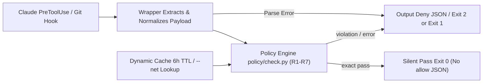

<h1 align="center">Claude Code Antileak Hooks</h1>

<p align="center">
  <a href="LICENSE"></a>
  <a href="#capability-scope--explicit-non-goals"></a>
</p>

<p align="center">
  <a href="README.md">简体中文</a> | <strong>English</strong>
</p>

<p align="center">
  <a href="https://claude-code-antileak-hooks.cbnv.me/en/">Documentation Site</a> · <a href="docs-site/en/api-reference/index.md">API &amp; Component Reference</a> · <a href="repo-docs/README.md">Source Guide (ZH)</a>
</p>

A two-layer leakage-prevention guardrail for Claude Code sessions and Git workflows: intercepts risky writes and credential reads offline before tool execution, then enforces private repo checks (`R1`), model/session regexes (`R2`), authorship (`R3`), private patterns (`R4`), agent branch blocking (`R5`), non-generic SSH commit signatures (`R6`), and redacted secret patterns (`R7`) at Git boundaries.

## Capability Scope & Explicit Non-Goals

- **How far it goes (Delivered)**:
  - Runs `6` offline `PreToolUse` wrappers (`Write|Edit|NotebookEdit`, `Bash`, `Read|Grep`) plus `1` `SessionStart` private list sync; passing wrappers exit `0` silently without emitting `permissionDecision: "allow"`.
  - Runs `4` `--net`-enabled Git hooks (`pre-commit`, `pre-merge-commit`, `commit-msg`, `pre-push`) enforcing `R1–R7`, direct `ssh-keygen -Y check-novalidate` commit verification, and `ls-remote`-anchored `known_content` resigning exemptions.
  - Ships clean `policy/policy.json` (zero private names/domains) and fails closed as `error` (exit `1`) when caches or credentials are missing or stale.
- **What it explicitly does NOT do**:
  - **Does not replace hosting platform rulesets**: `R5` blocks `15` agent branch prefixes, leaving `main` protection and force-push blocking to GitHub/CNB server rules.
  - **Excludes `Glob` filename listings** and cannot defeat a privileged local `root` user intentionally bypassing shell hooks (`tools/repo_maintenance_guard.py` is strictly for maintaining this clone, separate from user guardrails).
  - **Cannot run directly from a raw git clone**: `/root/.claude/...` templates must be rewritten to `$GUARD` via `policy/bootstrap.sh`; full wrapper/CLI contracts are documented in [API & Component Reference](docs-site/en/api-reference/index.md).

## Core Capabilities & Flow

- **Defense in Depth**: `settings.json` wires six `PreToolUse` wrappers and one `SessionStart` hook for fast offline prevention, backed by four `--net`-enabled Git hooks (`pre-commit`, `pre-merge-commit`, `commit-msg`, `pre-push`).
- **Clean Distribution Split**: `policy/policy.json` contains zero private repository names, internal hostnames, or credentials; private lists and `R4` patterns live solely in local `private-seed.json` (or `GUARD_SEED_B64`) and a `6h`-TTL cache, failing closed on absence or expiration.
- **Fail-Closed & Redacted Verdicts**: Shared `policy/check.py` separates `pass`, `violation`, and `error`; passing wrappers exit `0` silently (never emitting `allow` that skips interactive permission prompts), and secrets are redacted to 8 characters.
- **Direct SSH Verification Without `allowedSignersFile`**: Verifies commit `gpgsig` blocks via `ssh-keygen -Y check-novalidate` directly and supports `known_content` resigning exemptions anchored to real `git ls-remote` tips.

The diagram below shows how Claude tool wrappers and Git hooks converge on the shared policy engine:



## Quick Start

Checked-in scripts contain template paths that must be unpacked and rewritten into `$GUARD` (default `$HOME/.claude/guardrails`) by `policy/bootstrap.sh`. Default local CLI setup and check:

```bash
# 1. Install into $GUARD, rewrite paths, and wire global Git + Claude settings
HOOK_PACKAGE_URL=file:///path/to/guardrails-package.zip bash policy/bootstrap.sh

# 2. Deploy local-only seed & sanitize map (never committed to git)
cp private-seed.json sanitize-map.json "$HOME/.claude/guardrails/"
chmod 600 "$HOME/.claude/guardrails/private-seed.json" "$HOME/.claude/guardrails/sanitize-map.json"

# 3. Populate dynamic cache and run read-only verification (expects Overall: PASS)
python3 "$HOME/.claude/guardrails/hooks/refresh-private.py"
python3 "$HOME/.claude/guardrails/policy/doctor.py"
```

| Deployment Mode / Workflow | Key Entry & Scope | Documentation |
| --- | --- | --- |
| Cloud / Container Setup Script | Set `PKG_URL_DEFAULT`, `GUARD_SEED_B64`, and read-only platform tokens | [Cloud Setup](docs-site/en/docs/index.md#mode-b-cloud--container-environment-setup-script) |
| Extra Repos & `token-helper` | Target additional repos via `GUARD_REPOS` or compile XOR token wrapper | [Setup & Configuration](docs-site/en/docs/index.md) |
| R6 Personal SSH Signing Setup | Generate a dedicated `ed25519` key and set `commit.gpgsign=true` | [Contracts & Signing Rules](docs-site/en/docs/contracts.md) |
| Baseline Repository Audit | Scan HEAD or `--scan-history` with `hooks/scan-repo.py` | [Config Matrix & FAQ](docs-site/en/docs/configuration.md) |
| Contributing to This Repo | Install the repo-local offline guard (`tools/repo_maintenance_guard.py`) | [Contributing Guide](CONTRIBUTING.md) |

## Pre-Adoption FAQ

**Q1: Does the distributable package expose private repo names or internal URLs?**  
No. Private repository lists and `R4` patterns remain strictly inside local `private-seed.json` (or `GUARD_SEED_B64`) and local caches; `doctor.py` actively asserts zero reverse leakage into `policy.json`.

**Q2: Can I point `git config core.hooksPath` straight at `hooks/git` inside a fresh git clone?**  
No. Checked-in scripts contain hardcoded template paths that `policy/bootstrap.sh` must unpack and rewrite with `sed` to `$GUARD` before hooks will work reliably.

**Q3: Does this replace protected branch rules or stop a privileged local user intentionally disabling hooks?**  
No. `R5` intentionally leaves `main` protection and force-push blocking to hosting platform rulesets; local hooks catch accidental leaks early alongside mandatory remote protections.

**Q4: Why do Claude tool hooks fail closed when the cache expires instead of hitting the network?**  
If a hook exceeds its timeout while waiting on the network, Claude Code treats the killed hook as "no decision" and allows the tool call. Keeping `PreToolUse` hooks strictly offline prevents fail-open timeouts.

**Q5: How does `hooks/` differ from `tools/repo_maintenance_guard.py`?**  
`hooks/`, `hooks/git/`, and `policy/` are the deployable guardrail product, whereas `tools/repo_maintenance_guard.py` is an offline commit-format and blob guard solely for clones of this repository.

## Reading Paths

| Goal | Docs Site Section | Source Guide (`repo-docs/`) |
| --- | --- | --- |
| Install, configure seeds, & troubleshoot | [Setup & Deployment](docs-site/en/docs/index.md) · [Config Matrix & FAQ](docs-site/en/docs/configuration.md) | [Deployment & Checks](repo-docs/modules/deployment-and-checks.md) · [Private List Sync](repo-docs/modules/private-list-sync.md) |
| Hook JSON contracts, R1–R7, & extensions | [Contracts & Extension FAQ](docs-site/en/docs/contracts.md) · [API & Component Reference](docs-site/en/api-reference/index.md) | [Policy Engine](repo-docs/modules/policy-engine.md) · [Hook Wrappers](repo-docs/modules/hook-wrappers.md) · [Glossary](repo-docs/glossary.md) |
| Architecture diagram, walkthrough, & code map | [Architecture & Walkthrough](docs-site/en/docs/architecture.md) · [Code Map](docs-site/en/docs/code-map.md) | [One Real Run](repo-docs/walkthroughs/one-real-run.md) · [Code Map](repo-docs/code-map.md) |
| Migration history & source audit | [Changelog & Migration](docs-site/en/docs/changelog.md) | [Change Log](repo-docs/change-log.md) · [Source Evidence](repo-docs/references/source-evidence.md) · [Quality Review](repo-docs/references/quality-review.md) |

## License & Security

- **License**: Released under the [GNU Affero General Public License v3.0](LICENSE) (`AGPL-3.0-only`). This is an independent open-source project and is not affiliated with or endorsed by Anthropic.
- **Security & Contributions**: Review [Security Policy](SECURITY.md), [Contributing Guide](CONTRIBUTING.md), and [Agent Conventions](AGENTS.md) (keep `meta.json` aligned if capabilities or doc URLs change); never commit `private-seed.json`, `sanitize-map.json`, token files, or compiled `token-helper` binaries.
- **No Warranty**: Provided as-is under AGPLv3; pair local hooks with remote protected-branch rulesets and proper credential hygiene.
