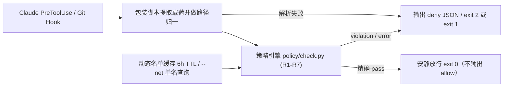

<h1 align="center">Claude Code Antileak Hooks</h1>

<p align="center">
  <a href="LICENSE"></a>
  <a href="#能力边界与明确非目标"></a>
</p>

<p align="center">
  <strong>简体中文</strong> · <a href="README.en.md">English</a> · <a href="https://claude-code-antileak-hooks.cbnv.me/">在线文档站</a> · <a href="docs-site/api-reference/index.md">API 与组件参考</a> · <a href="repo-docs/README.md">源码指南</a>
</p>

面向 Claude Code 会话与 Git 工作流的双层防泄漏护栏套件：在 Agent 工具调用前离线拦截违规写入与敏感文件读取，并在 Git 提交、合并和推送边界强制核验私有名单（R1）、模型与会话标记（R2）、作者署名（R3）、内部业务正则（R4）、Agent 分支（R5）、非通用 SSH 提交签名（R6）及凭据格式（R7）。

## 能力边界与明确非目标

- **能做到什么程度**：
  - 在 Claude Code 会话通过 `6` 个离线 `PreToolUse`（`Write|Edit|NotebookEdit`、`Bash`、`Read|Grep`）+ `1` 个 `SessionStart` 自动刷新动态名单，放行时仅静默退出 `0`（不返回 `permissionDecision: "allow"`）；
  - 在 Git `pre-commit`、`pre-merge-commit`、`commit-msg` 与 `pre-push` 携带 `--net` 执行全量 `R1–R7` 核验、直接 SSH `gpgsig` 密码学验签及以真实远端 `ls-remote` 为锚点的 `known_content` 重签豁免；
  - 随包分发的 `policy/policy.json` 不含任何私有仓名与业务域名正则，缺失或缓存过期统一 fail-closed 返回 `error`（退出 `1`）。
- **明确不做什么**：
  - **不替代托管平台分支保护**：`R5` 负责拦阻向 `15` 个 Agent 分支前缀推送，`main` 保护与强推禁止交给 GitHub Rulesets / CNB 分支规则；
  - **不拦截 `Glob` 路径枚举**，也不防御具备系统 `root` 权限用户的刻意绕过（`tools/repo_maintenance_guard.py` 仅服务于维护本仓库克隆自身，与产品钩子严格隔离）；
  - **不可直接运行未铺设克隆源码**：必须经 `policy/bootstrap.sh` 改写 `/root/.claude/...` 模板路径至 `$GUARD`；详细参数与示例见 [API 与组件参考](docs-site/api-reference/index.md)。

## 核心能力与拦截流转

- **工具层与 Git 层双保险**：`settings.json` 注册 6 个 `PreToolUse` 与 1 个 `SessionStart` 钩子负责低延迟离线阻断；4 个 Git 客户端钩子（`pre-commit`、`pre-merge-commit`、`commit-msg`、`pre-push`）携带 `--net` 执行最终对象级核验。
- **可分发配置与私有资产彻底隔离**：随包分发的 `policy/policy.json` 不含任何私有仓库名、内部域名或令牌；私有清单与 R4 正则仅驻留本机 `private-seed.json`（或云端 `GUARD_SEED_B64`）与 `6h` TTL 动态缓存，缺失或过期一律按 `error` 阻断。
- **Fail-Closed 三态裁决与脱敏**：单一策略引擎 `policy/check.py` 严格区分 `pass`、`violation` 与 `error`；放行仅安静退出 `0`（绝不输出会跳过宿主权限确认的 `allow`），命中凭据仅回显前 8 位与脱敏标识。
- **无 `allowedSignersFile` 直接 SSH 验签**：从提交对象直接剥离 `gpgsig` 并调用 `ssh-keygen -Y check-novalidate` 验签及核对指纹，同时支持以 `git ls-remote` 真实顶点为锚点的 `known_content` 重签豁免。

下面展示工具调用与 Git 钩子如何共享同一策略引擎并执行 fail-closed 拦截：



## 快速开始

源码中预置了模板路径，必须经由 `policy/bootstrap.sh` 铺设并改写到 `$GUARD`（默认为 `$HOME/.claude/guardrails`）后才可生效；以下为本机 CLI 默认安装与自检路径：

```bash
# 1. 下载或指定发布压缩包并完成铺设、路径改写及 Git/Claude 设置注入
HOOK_PACKAGE_URL=file:///path/to/guardrails-package.zip bash policy/bootstrap.sh

# 2. 部署本机私有种子与历史脱敏映射（仅留本机，严禁进入仓库）
cp private-seed.json sanitize-map.json "$HOME/.claude/guardrails/"
chmod 600 "$HOME/.claude/guardrails/private-seed.json" "$HOME/.claude/guardrails/sanitize-map.json"

# 3. 刷新私有名单缓存并执行只读自检（预期输出 Overall: PASS）
python3 "$HOME/.claude/guardrails/hooks/refresh-private.py"
python3 "$HOME/.claude/guardrails/policy/doctor.py"
```

| 部署场景 / 模式 | 核心要点与适用边界 | 详细指引 |
| --- | --- | --- |
| 云端容器 / Setup Script | 修改 `PKG_URL_DEFAULT`，注入 `GUARD_SEED_B64` 与只读平台令牌 | [多环境部署指南](docs-site/docs/index.md#方式二托管容器--云端-setup-script-部署) |
| 本机多仓库与 `token-helper` | 用 `GUARD_REPOS` 批量注入设置，或将令牌 XOR 混淆编译为本机可执行文件 | [部署方式与自检说明](docs-site/docs/index.md) |
| R6 个人 SSH 签名配置 | 生成独立 `ed25519` 密钥并配置 `commit.gpgsign=true` 与 `gpg.format=ssh` | [契约与签名规则说明](docs-site/docs/contracts.md) |
| 存量仓库基线审计 | 使用 `hooks/scan-repo.py` 审计当前树或 `--scan-history` 历史提交 | [配置矩阵与排错文档](docs-site/docs/configuration.md) |
| 维护本仓库自身提交 | 安装仓库内置的 `tools/repo_maintenance_guard.py` 离线提交守卫 | [贡献指南](CONTRIBUTING.md) |

## 选型前常见问题

**Q1：分发包和 `policy/policy.json` 会不会带出私有仓库名或内部域名？**  
不会。所有私有仓库清单与内部业务正则均保存在部署侧 `private-seed.json`（或云端环境变量）与本机缓存中，随包仅含通用规则，且 `doctor.py` 会主动检验不存在反向泄露。

**Q2：能否直接把克隆仓库里的 `hooks/git` 配成 `core.hooksPath` 使用？**  
不能。仓库源码中的钩子与配置保留了待替换模板路径，必须由 `policy/bootstrap.sh` 解包并用 `sed` 改写为实际 `$GUARD` 路径后才能正常运行。

**Q3：本套件能否代替托管平台受保护分支，或阻止具备高权限的用户刻意绕过？**  
不能。规则 R5 有意将受保护分支与强推拦截交给托管平台规则集；工具层与本地钩子旨在低延迟防止误操作与会话泄露，最终强防线仍需结合远端权限管控。

**Q4：为什么 Claude Code 工具钩子不直接联网，而在缓存过期时直接阻断？**  
因为宿主对工具钩子设有超时机制，超时被终止后会被视作“无决策”并直接放行。为了彻底避免 fail-open，所有 `PreToolUse` 包装脚本绝不传 `--net`，由 `SessionStart` 或 Git 层负责刷新。

**Q5：`hooks/` 与 `tools/repo_maintenance_guard.py` 有什么区别？**  
`hooks/`、`hooks/git/` 与 `policy/` 是部署到使用者环境的产品套件；`tools/repo_maintenance_guard.py` 则是维护本仓库自身克隆的离线对象扫描与 Conventional Commits 检查器，两者职责完全独立。

## 文档导读路径

| 阅读目标 | 用户文档站入口 | 仓库源码指南入口 |
| --- | --- | --- |
| 安装部署、环境变量矩阵与常见排错 | [起步与配置部署](docs-site/docs/index.md) · [配置与排错](docs-site/docs/configuration.md) | [部署安装与自检模块](repo-docs/modules/deployment-and-checks.md) · [动态名单同步模块](repo-docs/modules/private-list-sync.md) |
| 钩子 JSON 契约、R1–R7 规则与扩展 | [接口与扩展契约](docs-site/docs/contracts.md) · [API 与组件参考](docs-site/api-reference/index.md) | [策略引擎模块](repo-docs/modules/policy-engine.md) · [双层钩子包装模块](repo-docs/modules/hook-wrappers.md) · [术语表](repo-docs/glossary.md) |
| 架构图、真实调用走读与代码导航 | [架构全景与主流程](docs-site/docs/architecture.md) · [代码地图](docs-site/docs/code-map.md) | [一次真实写入判定](repo-docs/walkthroughs/one-real-run.md) · [代码地图](repo-docs/code-map.md) |
| 版本迁移决策与源码审计记录 | [版本变更与迁移](docs-site/docs/changelog.md) | [指南变更记录](repo-docs/change-log.md) · [源码证据审计](repo-docs/references/source-evidence.md) · [阅读质量审计](repo-docs/references/quality-review.md) |

## 许可证与安全协作

- **开源协议**：本项目基于 [GNU Affero General Public License v3.0](LICENSE)（`AGPL-3.0-only`）开源发布，是独立维护的开源防泄漏工具链，与 Claude Code 官方不构成隶属或背书关系。
- **安全与贡献规范**：提交变更前请先阅读 [安全说明](SECURITY.md)、[贡献指南](CONTRIBUTING.md) 与 [协作约定](AGENTS.md)（涉及功能或文档站入口调整时需同步核对 `meta.json`）；切勿将本机 `private-seed.json`、`sanitize-map.json`、任何访问令牌或编译后的 `token-helper` 提交至版本控制仓库。
- **独立社区工具免责**：按原样提供，请配合托管平台受保护分支与独立凭证管理使用。
