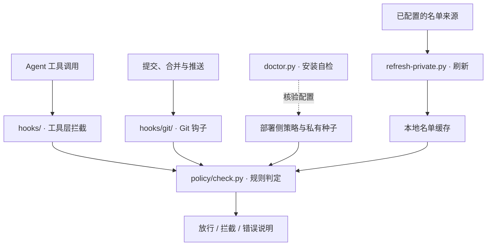

# Claude Code Antileak Hooks 🛡️

> **用于 Agent 协作与 Git 提交的内容检查、署名和签名护栏。**

[部署与规则](docs/OPERATIONS.md) · [变更记录](docs/CHANGELOG.md) · [GPLv3](LICENSE)

通过 Claude Code hooks 提前提示，通过 Git hooks 检查实际提交与推送。它用于减少误操作和意外泄露；拥有本机控制权的进程仍能绕过本机检查。

<a id="-系统结构"></a>

**阅读导航**

[🏛️ 系统结构](#section-1) · [🚀 快速开始](#section-2) · [⚙️ 检查范围](#section-3) · [📚 维护与许可](#section-4) · [🧪 验证与故障定位](#section-5)

---

<a id="section-1"></a>

## 🏛️ 系统结构



| 路径 | 职责 |
|---|---|
| `policy/policy.json` | 规则配置与路径声明 |
| `policy/check.py` | 内容、提交、推送三个检查入口 |
| `hooks/` | 工具调用检查、私有仓库名单刷新与存量扫描 |
| `hooks/git/` | Git 提交、合并及推送钩子 |
| `policy/bootstrap.sh` | 安装、路径配置与钩子接入 |
| `policy/doctor.py` | 安装状态与配置自检 |

私有仓库名单由 CNB、可选 GitHub 来源和本机种子汇总，业务标识与凭据保存在部署环境。公共分发包只包含规则和实现。

<a id="-快速开始"></a>

<a id="section-2"></a>

## 🚀 快速开始

运行环境为 Bash、Python 3、Git 和 OpenSSH。先按 [部署参考](docs/OPERATIONS.md) 配置名单来源、本机种子与安装路径，再使用 `policy/bootstrap.sh` 安装。

安装后可先运行只读检查：

```sh
python3 policy/doctor.py
```

详细安装命令、云端与本机的区别、名单刷新方式见 [部署与规则](docs/OPERATIONS.md)。不要把本机名单、凭据或带凭据的辅助程序打进分发包。

<a id="-检查范围"></a>

<a id="section-3"></a>

## ⚙️ 检查范围

| 规则 | 检查内容 |
|---|---|
| R1 / R4 | 私有仓库名称与内部业务标识 |
| R2 | 具体模型标识与会话标记 |
| R3 | 人类作者与 Agent 协作署名 |
| R5 | Agent 命名分支 |
| R6 | SSH 提交签名 |
| R7 | 凭据值与私钥形态 |

检查结果区分通过、违规与执行错误；错误按拒绝处理。快速工具钩子不联网，Git 检查可刷新名单。缓存缺失或过期时按提示修复来源，不把“无法检查”当作通过。

<a id="-维护与许可"></a>

<a id="section-4"></a>

## 📚 维护与许可

- [部署与规则](docs/OPERATIONS.md)：配置、安装、检查模式及适用边界。
- [历史变更](docs/CHANGELOG.md)：编码、路径、签名和名单来源问题的修复记录。
- [协作约定](CLAUDE.md)：内容卫生与署名要求。

代码采用 [GPLv3](LICENSE)。


<a id="section-5"></a>

## 🧪 验证与故障定位

先运行 `python3 policy/doctor.py` 核对安装路径、配置和 Git 钩子，再按 [操作说明](docs/OPERATIONS.md) 分别检查内容、提交和推送入口。安装自检不能替代真实拦截验证；需要确认缺配置、缺名单和违规样本按设计返回非成功结果。

`settings.json` 是工具钩子接线入口，`policy/` 是 Git 检查实现；更换安装位置时须一起核对，避免工具层有提示而 Git 层没有接上。
